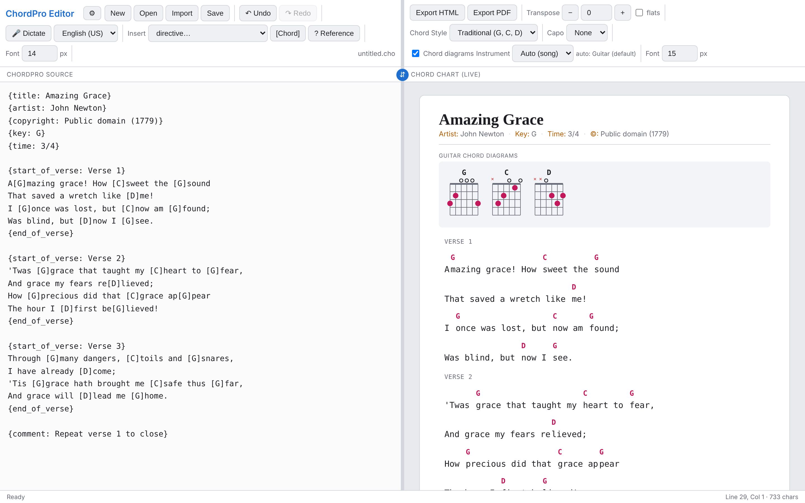
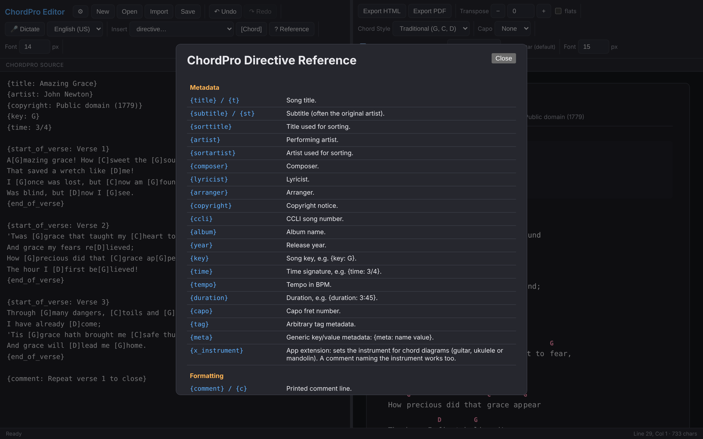
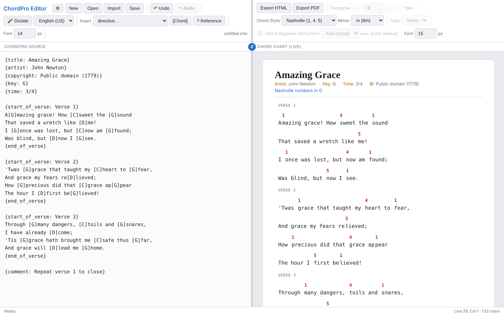
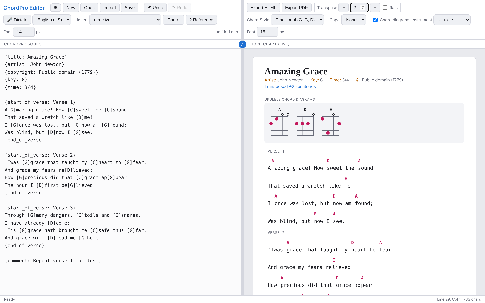
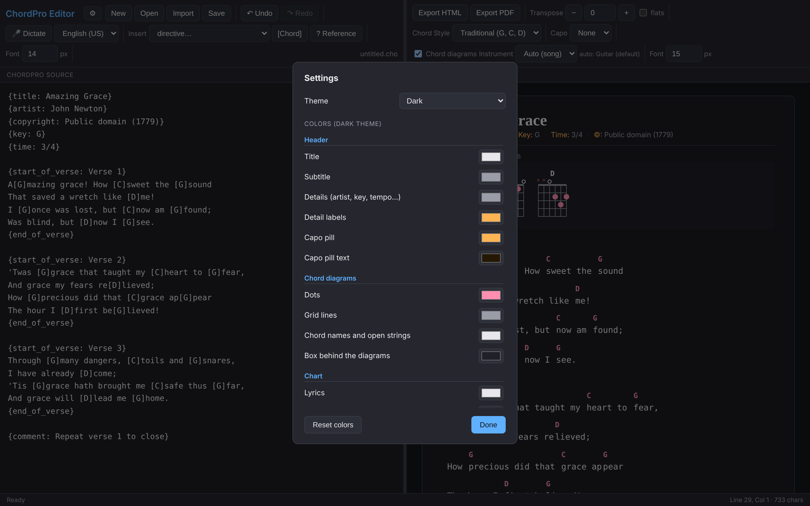

# ChordPro Editor

A browser-based editor for [ChordPro](https://www.chordpro.org/) song sheets. Type chords and lyrics on the left, see a formatted chord chart update live on the right.

No build step, no server, no install: open `index.html` and start writing.



## Features

**Editing**
- Live preview as you type, with optional line-for-line synced scrolling between source and chart
- Undo/redo history (Ctrl+Z / Ctrl+Y), Tab / Shift+Tab indenting
- Insert menu for every supported directive, plus a `[Chord]` button that wraps the selection
- Built-in directive reference (`? Reference`)
- Speech dictation for lyrics (Chrome/Edge), in several languages
- Separate font sizes for the source and the chart



**Chord chart**
- Chords drawn above the lyrics, with verse / chorus / bridge / tab / grid sections
- `{chorus}` repeats the last chorus
- Transpose (±11 semitones, sharps or flats)
- Capo: writes `{capo:}` and shows the chords actually sounded
- Chord styles: Traditional (G, C, D), Nashville numbers (1, 4, 5) or Roman numerals (I, IV, V), counted from `{key:}`
  - Roman mode marks secondary dominants (e.g. `V/IV`)
  - Nashville minor shown as `6m` or `6-`
- Beat marks: trailing slashes such as `G/` (2 beats) or `G///` (4 beats)



**Chord diagrams**
- Guitar, ukulele and mandolin, about 290 shapes each
- Instrument picked by hand or detected from `{x_instrument:}` or a comment naming the instrument
- Custom shapes with `{define:}`
- Handles aliases (`min`, `-`, `M7`, `sus`, `add2`, …), enharmonic roots, and ignores slash-bass notes



**Import / export**
- Open and save `.cho`, `.crd`, `.chopro`, `.chordpro`, `.txt` (saves back to the same file in Chrome/Edge)
- Import chord-over-lyrics charts from `.docx` or `.pdf`, converted to inline ChordPro:
  - Title / artist, key, tempo, time, copyright and CCLI pulled from the header
  - Verse / Chorus / Bridge / Intro / Outro / Tag headings become sections
  - Repeated choruses become `{chorus}`
- Drag and drop a `.docx`, `.pdf` or `.cho` file onto the window
- Export the chart as standalone HTML or as PDF (via the print dialog)

<!-- TODO screenshot: import a .docx or .pdf chord chart and capture the converted ChordPro next to the chart. Save as docs/screenshots/import.png -->
<!--  -->

<!-- TODO screenshot: an exported PDF page (e.g. "Save as PDF" from Export PDF). Save as docs/screenshots/export-pdf.png -->
<!--  -->

**Settings**
- Light, dark or system theme
- Color pickers for lyrics, chords, sections, comments, header and diagrams (exports always use the light-theme colors)
- Preferences are saved in the browser's `localStorage`



## Getting started

1. Clone or download the repository.
2. Open `index.html` in a browser.
   - Chrome or Edge recommended: needed for dictation and for saving back to the opened file.
3. Edit the sample song, or click **New**.

Optional local server (any static server works):

```sh
python -m http.server 8000
# then open http://localhost:8000
```

**Dependencies** (loaded from jsDelivr, only needed for import):
- [mammoth](https://github.com/mwilson/mammoth.js) 1.8.0 for `.docx`
- [pdf.js](https://mozilla.github.io/pdf.js/) 3.11.174 for `.pdf`

Everything else works offline.

## ChordPro basics

Chords go in square brackets right before the syllable they fall on. Directives go in curly braces.

```chordpro
{title: Amazing Grace}
{artist: John Newton}
{copyright: Public domain (1779)}
{key: G}
{time: 3/4}

{start_of_verse: Verse 1}
A[G]mazing grace! How [C]sweet the [G]sound
That saved a wretch like [D]me!
I [G]once was lost, but [C]now am [G]found;
Was blind, but [D]now I [G]see.
{end_of_verse}

{start_of_verse: Verse 2}
'Twas [G]grace that taught my [C]heart to [G]fear,
And grace my fears re[D]lieved;
How [G]precious did that [C]grace ap[G]pear
The hour I [D]first be[G]lieved!
{end_of_verse}

{start_of_verse: Verse 3}
Through [G]many dangers, [C]toils and [G]snares,
I have already [D]come;
'Tis [G]grace hath brought me [C]safe thus [G]far,
And grace will [D]lead me [G]home.
{end_of_verse}

{comment: Repeat verse 1 to close}
```

Common directives:

| Directive | Purpose |
|---|---|
| `{title:}` `{subtitle:}` `{artist:}` | Song header |
| `{key:}` `{time:}` `{tempo:}` `{capo:}` | Song details (key also drives Nashville/Roman) |
| `{comment:}` `{comment_italic:}` `{comment_box:}` | Notes in the chart |
| `{start_of_verse}` … `{end_of_verse}` | Verse (also `chorus`, `bridge`, `tab`, `grid`) |
| `{chorus}` | Repeat the last chorus |
| `{define: Am base-fret 1 frets x 0 2 2 1 0}` | Custom chord diagram |
| `{x_instrument: ukulele}` | Pick the diagram instrument for this song |
| `{copyright:}` `{ccli:}` | Rights info |

Short aliases work too (`{t:}`, `{c:}`, `{soc}`, `{eoc}`, …). The full list is under **? Reference** in the app.

## Project layout

```
index.html          App shell: toolbars, panes, dialogs
style.css           UI styles and theme colors
js/
  parser.js         ChordPro source -> AST
  directives.js     Directive table and aliases
  renderer.js       AST -> chart HTML
  chords.js         Transpose, chord theory, diagram shapes
  instruments.js    Instrument definitions and detection
  chart-style.js    Chart CSS (shared by preview and exports)
  settings.js       Theme and color settings
  docx-chords.js    Chord-above-lyrics text -> inline ChordPro (.docx import)
  pdf-chords.js     PDF text extraction with column alignment
  app.js            UI wiring: files, undo, export, dictation, capo, sync scroll
docs/screenshots/   README images
```

Plain HTML, CSS and vanilla JavaScript; each module is an IIFE exposing one global.

## Known limitations

- Transpose changes the view only, not the source text.
- `{start_of_grid}` blocks are shown as plain text, not as a chord grid.
- Some layout directives (fonts, columns, page breaks) are recognized but not rendered.
- Diagrams are hidden in Nashville and Roman modes.

## License

<!-- TODO: choose a license (e.g. MIT) and add a LICENSE file -->
TBD
